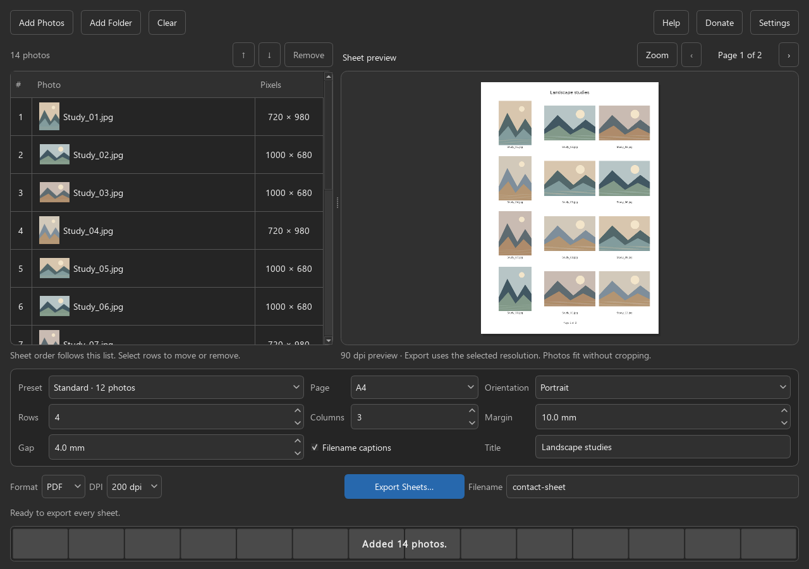

# Contact Sheet Maker

A private Steady State Studio desktop utility for turning local JPEG and PNG photos into printable contact sheets. Every feature is free. Optional support: https://ko-fi.com/steadystatestudio



## What works

- Add selected photos, one folder, or dropped files/folders. Folder imports are naturally sorted (`2` before `10`), deduplicated and non-recursive.
- Visible ordering with multi-row Up/Down, Remove and Clear; thumbnail list and full-sheet preview.
- A4 or US Letter, portrait/landscape, rows/columns, millimetre margins/gaps, filename captions and optional sheet title.
- Three print presets (12, 20, or 6 photos); last layout/export choices and window arrangement are remembered locally.
- Resizable table/preview split, page navigation and a scrollable full-resolution Zoom preview.
- Multipage PDF or numbered JPEG sheets at 150, 200 or 300 dpi. Photos always fit without cropping; EXIF rotation is honoured.
- System/Dark/Light appearance, keyboard shortcuts, readable focus borders and accessible control labels.
- Background import, preview and export with cancellation. Close during work asks first and waits for safe cleanup.
- Import feedback stays visible after the preview finishes: added, already-listed and unreadable photos are counted separately. Missing or unreadable selections are reported while valid selections are added. Cancelling an import leaves the photo list unchanged.

## Run from source

Python 3.10+ (tested with Python 3.12 on Debian 13 x86_64):

```sh
python -m venv .venv
# Linux/macOS
. .venv/bin/activate
# Windows PowerShell instead: .venv\Scripts\Activate.ps1
python -m pip install -e .
python -m contact_sheet
```

For the exact development dependency versions use `python -m pip install -r requirements-build-lock.txt` first. All packages come from the normal Python package index; no global installation is necessary. Installing requires Internet access; the running app does not.

### Original local Linux development build

Extract the supplied `Contact-Sheet-Maker-linux-x86_64.tar.gz` and run `Contact-Sheet-Maker/Contact-Sheet-Maker`. Keep the `_internal` directory next to the executable. Python and Qt are bundled. Built and offscreen-smoke-tested on Debian 13 x86_64; not an AppImage and not promised compatible with older distributions. A desktop display and normal Qt/X11 or Wayland system libraries are needed for interactive use. This build uses glibc 2.41; build from source on older systems.

### Windows

See `packaging/README-WINDOWS.txt` for exact native build commands and the remaining interactive smoke checklist. The Windows CI job produces a native portable ZIP after tests and packaged smoke checks pass. Check the exact commit run before treating a package as validated; PyInstaller must run on Windows to create its native executable.

## Workflow

1. Add photos/folder. Select rows and use ↑/↓ to establish print order; Alt+Up/Down also works, Delete removes selected rows, Ctrl+O adds photos.
2. Choose a preset or customize the layout. The current preview must finish successfully before Export enables. Use page arrows and Zoom to inspect it.
3. Choose format, DPI and filename. Export Sheets asks for a destination directory. `contact-sheet.pdf` is one multipage PDF; JPEG yields `contact-sheet-001.jpg`, `contact-sheet-002.jpg`, etc.
4. If output names already exist, choose Replace, Keep Both, or Cancel. Keep Both uses one unused filename for the whole batch, such as `contact-sheet (2)`; Cancel leaves everything unchanged. Open Folder appears after success.

Removing selected photos keeps the next remaining row selected so you can continue with the keyboard. Moving photos keeps the current row with its photo; Delete and Alt+Up/Down act only inside the photo list. Hover a photo row to read its full path. Duplicate-only additions preserve your selection and preview. Open Folder remains available for the last successful export after later imports or cancelled operations; its tooltip identifies that folder.

PDF page dimensions match the selected paper. Captions are rendered at 8 pt and the optional title at 14 pt. Pages are raster images inside the PDF, so text is not selectable/searchable. The 90-dpi UI preview uses the same layout renderer; exported pages use the chosen higher DPI. Fonts and image resampling can make small preview text appear slightly different, while positions and full-photo fitting remain consistent.

## Privacy and safety

No telemetry, automatic upload, cloud account, subscription, watermark, or feature gate. Donate opens the Studio Ko-fi page only when clicked. Help and processing are local. The app saves ordinary UI preferences and last chosen folder paths with Qt settings; the loaded photo list is not persisted.

Original photos are never modified. Output names cannot replace source files, including hardlink aliases. Files are inspected as actual JPEG/PNG content, corruption is reported, and images above 60 million pixels are refused. Very large compressed files can still take time to read; native decoder calls cannot be interrupted halfway through, so cancellation is checked between safe steps. Source fingerprints detect photos changed since import or while generating sheets and stop export rather than quietly using mixed versions.

All sheets render into a temporary directory inside the selected destination before commit. Existing outputs require explicit replacement; exclusive installation rejects unexpected files that appear during export. Cancellation and ordinary commit failures roll back installed files and restore previous outputs. If another process blocks restoration, the error identifies retained backups for manual recovery. If export succeeds but old backups cannot be removed, the app confirms the sheets were saved and lists those backups separately.

On filesystems without hardlinks, an exclusive-create copy fallback is used (Windows first uses native no-replace rename). The copy fallback can briefly expose an incomplete newly created output. **Abrupt process termination, power loss, disk failure or outside modification during a multi-file commit cannot guarantee rollback.** Do not point another program at output files while exporting; keep backups of important prior sheets. Filesystem fallback is fault-injection-tested here, not tested against a physical exFAT volume.

## Tests and development

```sh
python -m pip install -e ".[test,build]"
QT_QPA_PLATFORM=offscreen python -m pytest -q
python scripts/render_preview.py
python scripts/fetch_appimagetool.py  # Linux only: pinned tool and runtime
python scripts/build.py
python scripts/smoke_bundle.py dist/Contact-Sheet-Maker/Contact-Sheet-Maker
```

On Windows set `QT_QPA_PLATFORM=offscreen` in the environment if you want headless tests, or run with the normal desktop Qt platform. The renderer creates original synthetic landscape art, screenshots and real sample output under `docs/`; no user photographs are packaged. `docs/VALIDATION.md` records the checks actually run.

## Windows and Linux build workflow

`.github/workflows/build.yml` runs on pushes, pull requests and manual dispatch. It installs the exact dependency lock, runs the complete suite on Windows Server 2022 and Ubuntu 22.04, builds native packages, and smoke-tests the actual packaged executables. Linux also smoke-tests the AppImage without requiring FUSE.

Download successful private artifacts from the repository's Actions run:
- `Contact-Sheet-Maker-Windows-<commit>` contains the portable Windows ZIP.
- `Contact-Sheet-Maker-Linux-<commit>` contains the Linux AppImage and portable tar archive.
- Separate `Contact-Sheet-Maker-QA-<OS>-<commit>` artifacts contain the JUnit report and generated smoke screenshots/sample sheets.

Packages include `BUILD-INFO.json` (exact source commit, source hashes and dependency versions) and accompanying `SHA256SUMS.txt`. Actions use fixed commit SHAs. AppImage packaging verifies both its tool and runtime by fixed size and SHA-256 before execution; there are no mutable `latest` downloads. The workflow has read-only repository permissions and never publishes a release. Artifacts expire after 14 days.

The smoke test imports 13 synthetic photos with Unicode filenames through the real UI, exports two pages as PDF/JPEG, checks physical page sizes and DPI, verifies input hashes, and captures the UI. It has a 120-second external timeout. This is automated native/headless validation, not a claim of human usability testing. See each exact commit's Actions result for its verified platform status.

For a native folder/archive build without AppImage tooling, use `python scripts/build.py --bundle-only`. Smoke output must use a fresh directory; the runner refuses to replace an existing report.

## Deliberate limits / remaining work

- JPEG and PNG only; no RAW, HEIC, TIFF, video or animated-frame selection. For animated PNG, only the first frame is used.
- No direct printer integration, crop-to-fill, borders, per-photo caption editing, saved projects or recursive folder traversal.
- Unicode paths work. Caption glyph coverage is font-dependent; DejaVu Sans is bundled for broad Latin/Greek/Cyrillic coverage, with platform CJK font fallback where installed. Emoji and every writing system are not guaranteed.
- The 60M-pixel safety cap and one-source-at-a-time rendering bound large decoded images, but this is not a hardened untrusted-file sandbox. PNG decoding may still require substantial memory. PDF encoding retains compressed document data, so very large documents can consume increasing memory.
- Interactive Windows behavior, high-DPI displays, screen readers, physical USB filesystems, distribution signing and wider Linux compatibility still need real-device validation before a public release. Native CI results are recorded per commit and do not imply human QA.

MIT license, copyright © 2026 Steady State Studio. The actual File Renamer theme/status component was adapted under its MIT license; exact provenance and dependency notices are in `THIRD_PARTY_NOTICES.md`. Development remains private. The workflow saves private CI artifacts and does not publish releases.
