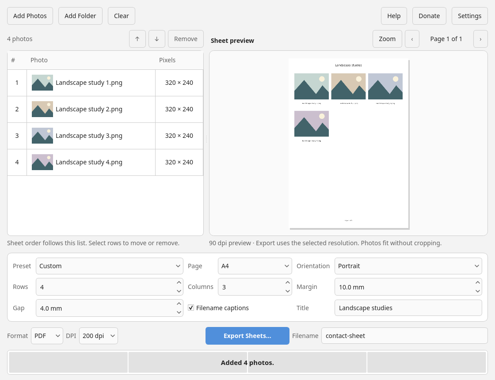
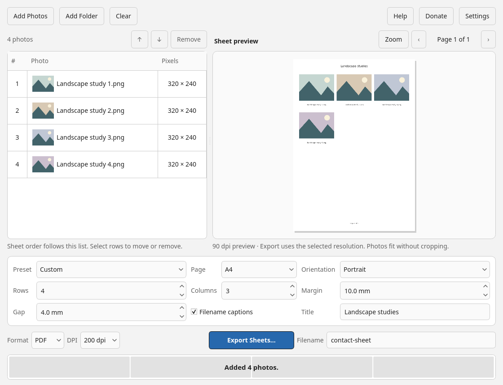
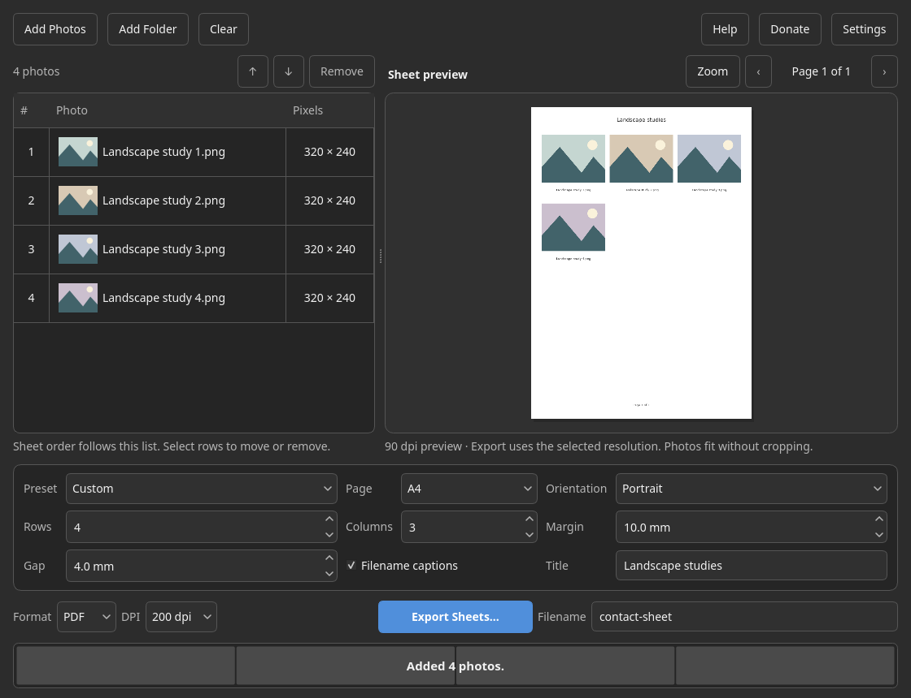

# Contact Sheet Maker desktop trust pilot

Private review only. Based on main `93cc02825ee70bad41a644cb18bc6258d90a37e1`.
No merge, release, repository-visibility change, Android change, paid gate, or suite-wide rollout.

## Three changes

1. Mixed selections now report the unique unsupported files skipped, separately from photos added, duplicates, and load failures. JPEG/PNG filtering, natural ordering, nonrecursive folders, and the existing all-unsupported explanation remain. Duplicate/unsupported-only additions preserve the current preview and selection. Unrelated unsupported sidecars disappearing or becoming unreadable during collection do not discard supported photos.
2. Export reports **Rendering**, **Checking sources**, and **Saving**. Rendered-page counts stay separate from a committed output. Rendering leaves at least a tenth of the progress bar unfilled (not a time estimate); checking and saving are non-determinate. Only the successful result fills the bar and displays the existing saved receipt. Queued updates cannot replace “Cancelling safely…”. Source checks, collision handling, exclusive writes, rollback, and retained-backup reporting are unchanged.
3. The primary action uses restrained accessible blue tokens, with a contrasting focus indicator and neutral disabled styling. Spin boxes receive the same visible keyboard-focus treatment. No layout, padding, control order, action count, or default setting changes were made. Automatic preview scheduling and the current-preview export gate remain in place.

## Source and UI verification

- Exact repository build/test dependency lock, Python 3.12, Linux Qt Fusion offscreen.
- Final full source suite: **206 passed in 118.83 seconds**. Independent read-only review cleared the unsupported-sidecar race and found no remaining blocking issue.
- Targeted additions cover direct/folder mixed selections; accepted/skipped/failed/duplicate counts; no-op preview preservation; unsupported-file races; PDF/JPEG phase order; cancellation at checking/commit; a paused PDF finalization/check/commit fixture; rendered text/focus contrast; disabled states; and focus geometry.
- Existing source-changed-after-render, partial-commit rollback, mid-commit cancellation, and retained-backup regressions remain unchanged and are included in the full suite.
- Source smoke exercised the real GUI import/preview/export workers with 13 synthetic Unicode-named photos, a two-page PDF and two JPEG sheets; every input hash stayed unchanged.
- Byte compilation, dependency compatibility, whitespace checking, and Ruff fatal/error checks (`E9,F63,F7,F82`) pass. The repository has no configured style-lint target; this is not a claim of a full style-lint pass.

### Before and after

These are actual native-resolution UI screenshots from the same synthetic Qt/offscreen fixture, with primary keyboard focus. “Before” uses the main theme and “after” the pilot theme. They are not physical-device validation.

| Light before | Light after |
| --- | --- |
|  |  |

| Dark before | Dark after |
| --- | --- |
|  |  |

The full visual fixture covered light/dark, 10.5/15.75 pt text, 1120×860/640×480 client sizes, and primary/spinbox focus. All 16 before/after pairs retained identical rectangles for 17 controls. No new clipping or movement was found. Compact work-area scrolling and enlarged table-label elision are pre-existing behavior; 150% application-font enlargement is not OS display scaling.

White primary text contrast, normal/hover/pressed: **5.72 / 5.33 / 6.16:1**, up from approximately **3.34:1**. Focus contrast against primary fills is at least **3.06:1** in light and **5.00:1** in dark; against surrounding surfaces it is at least **17.01:1** and **12.39:1**, respectively. These are measured opaque-sRGB ratios, not a formal accessibility certification.

## Bounded synthetic scale checks

One isolated subprocess per case, 12 photos/page at 200 DPI. Generated patterned RGB JPEG/PNG sources were 240–320 pixels, with Unicode and long filenames; they are **not a full-resolution camera corpus**. Timings exclude fixture generation and output verification. Peak RSS is the Linux process high-water mark through import/export, not post-export PDF parsing.

| Photos / output | Pages | Import | Export | Peak RSS |
| --- | ---: | ---: | ---: | ---: |
| 500 / PDF | 42 | 1.19 s | 23.06 s | 172.4 MiB |
| 500 / JPEG | 42 | 1.15 s | 4.38 s | 75.1 MiB |
| 2,000 / PDF | 167 | 4.56 s | 88.84 s | 542.1 MiB |
| 2,000 / JPEG | 167 | 5.12 s | 16.55 s | 87.3 MiB |

All PDF pages parsed and JPEG dimensions/DPI verified; source hashes were unchanged. The 2,000-photo PDF was 168.36 MB, versus 56.43 MB across JPEGs: PDF memory/output growth remains a real limitation, not a constant-memory claim. The first three scale cases loaded the pilot before the final unsupported-sidecar race correction; the last JPEG case and GUI checks loaded the corrected core. The export path is identical across those revisions. No performance optimization was made.

A separate offscreen 2,000-photo GUI import took 20.86 s; a requested 20 ms event-loop timer had a 29.28 ms p95 and a 575.76 ms maximum gap. This exposes a brief import/UI stall rather than proving uninterrupted responsiveness. Cancellation after 50 import candidates and after three PDF/JPEG rendered pages preserved the prior list/output bytes, removed staging files, and finished approximately 4–5 ms after the observed cancellation request. These are single-run shared-cloud measurements, not hardware acceptance or cancellation-latency guarantees.

## Remaining limits

Native Windows and Ubuntu packaging/smoke results must be checked on the exact draft-PR head's Actions run. Source/offscreen tests do not establish physical high-DPI, multi-monitor, screen-reader, removable-filesystem, or real-camera-photo performance. Nothing here changes the documented power-loss and filesystem-fallback limitations.
